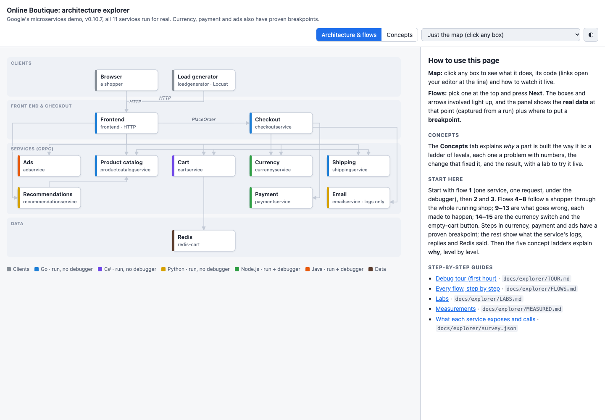

# claude-kits, proven on a real app

**[claude-kits](https://github.com/myhts/claude-kits) applied to an 11-service, 5-language shop, one stage at a
time: every feature run for real, every number measured, every claim checked against the code.**

**[Open the live explorer](https://myhts.github.io/claude-kits-boutique/explorer/explorer.html)** ·
[Read the stage-by-stage record](docs/claude-kits/README.md) · [Get claude-kits](https://github.com/myhts/claude-kits)

> This is a copy of Google's [Online Boutique](https://github.com/GoogleCloudPlatform/microservices-demo), kept with
> its full history under the [Apache License 2.0](LICENSE). **Not affiliated with Google.** Google's original README
> follows the line further down.

[](https://myhts.github.io/claude-kits-boutique/explorer/explorer.html)

## One command, and what it found

`/pipeline:project-explorer` read all 11 services, ran them in Docker, and turned the shop into a page you can click
through with a debugger. Nobody asked it to hunt for bugs. It found them anyway, then made each one happen:

- **An order ships for $0.00.** Pick a currency the shop has no rate for: every price shows `$0.00`, and the order is
  charged, shipped and confirmed.
- **Two add-to-carts at once lose an item**, in 17–18 carts out of 20.
- **One order, two charges**, when shipping fails after the payment and the shopper tries again.
- **Payment writes the full card number and CVV to its log.**

[Stage 2: the first seven findings](docs/claude-kits/02-the-architecture.md#what-it-found) ·
[Stage 2b: the whole shop, every bug run](docs/claude-kits/02b-the-whole-shop.md#what-it-found)

| 15 flows · 78 steps | 22 breakpoints | 11 measurements | 2 runs |
|---|---|---|---|
| a shopper from home page to placed order, and five ways it goes wrong, each made to happen | each one proven to stop on a real request; 20 again from clicks in the real shop | each with its command and raw output | **$20.63** at list price for both ($12.49 + $8.14) |

## The stages

| Stage | What it proves | Status | Read it |
|---|---|---|---|
| **1 Who reads the code** | Cheaper Sonnet readers found everything Opus found, at about half the cost | Done | [Page](docs/claude-kits/01-who-reads-the-code.md) · [ADR 0001](docs/claude-kits/adr/0001-explorer-readers-on-sonnet.md) |
| **2 The architecture** | `/project-explorer`: the map, flows run for real or traced from code, concept ladders and labs | Done | [Page](docs/claude-kits/02-the-architecture.md) · [Live explorer](https://myhts.github.io/claude-kits-boutique/explorer/explorer.html) |
| **2b The whole shop** | All 11 services run; every traced bug made to happen through the real shop | Done | [Page](docs/claude-kits/02b-the-whole-shop.md) |
| **3 Set up the flow** | `/setup-project` on five languages: every command run before it was written down, five failing checks found (four fixed first, one tracked in [#7](https://github.com/myhts/claude-kits-boutique/issues/7)), `main` gated on `verify` and `human-review` | Done | [Page](docs/claude-kits/03-set-up-the-flow.md) · [Feedback (9 issues)](docs/claude-kits/03-set-up-the-flow.md#feedback-for-claude-kits) |
| 4 Features, end to end | plan, spec, tickets, test-first build, reviewers, human review | Next | |
| 5 The reviewers | the reviewers on real code with planted defects | To come | |
| 6 Ship it | images per changed service, `/deploy`, rollout and undo | To come | |
| 7 Retro | what worked, what didn't, what it cost | To come | |

Every stage page has the same shape: what the feature is for, what we typed, what Claude did, what we decided, the
evidence, what it cost, and what didn't work.

## Try it yourself

| | |
|---|---|
| **Just look** | [The live explorer](https://myhts.github.io/claude-kits-boutique/explorer/explorer.html). Start with flow 1, then flow 10: the free order |
| **Follow a request in a debugger** | [The first-hour tour](docs/explorer/TOUR.md): start three services with `docs/explorer/run-services.sh debug`, attach VS Code, watch a request stop at each step |
| **Break it** | [The labs](docs/explorer/LABS.md): freeze a service, cap its CPU, flood it, and watch the numbers from the concept pages happen on your laptop |

## What's here

```text
docs/claude-kits/   the record: one page per stage, decisions (ADRs), evidence, costs
docs/explorer/      the explorer: the page, its data, guides, measurements, and the scripts that run the services
everything else     Google's Online Boutique, changed only through pull requests listed in docs/claude-kits/
```

---

*Google's original README, unchanged:*

<!-- <p align="center">

</p> -->


**Online Boutique** is a cloud-first microservices demo application.  The application is a
web-based e-commerce app where users can browse items, add them to the cart, and purchase them.

Google uses this application to demonstrate how developers can modernize enterprise applications using Google Cloud products, including: [Google Kubernetes Engine (GKE)](https://cloud.google.com/kubernetes-engine), [Cloud Service Mesh (CSM)](https://cloud.google.com/service-mesh), [gRPC](https://grpc.io/), [Cloud Operations](https://cloud.google.com/products/operations), [Spanner](https://cloud.google.com/spanner), [Memorystore](https://cloud.google.com/memorystore), [AlloyDB](https://cloud.google.com/alloydb), and [Gemini](https://ai.google.dev/). This application works on any Kubernetes cluster.

If you’re using this demo, please **★Star** this repository to show your interest!

**Note to Googlers:** Please fill out the form at [go/microservices-demo](http://go/microservices-demo).

## Architecture

**Online Boutique** is composed of 11 microservices written in different
languages that talk to each other over gRPC.

[](/docs/img/architecture-diagram.png)

Find **Protocol Buffers Descriptions** at the [`./protos` directory](/protos).

| Service                                              | Language      | Description                                                                                                                       |
| ---------------------------------------------------- | ------------- | --------------------------------------------------------------------------------------------------------------------------------- |
| [frontend](/src/frontend)                           | Go            | Exposes an HTTP server to serve the website. Does not require signup/login and generates session IDs for all users automatically. |
| [cartservice](/src/cartservice)                     | C#            | Stores the items in the user's shopping cart in Redis and retrieves it.                                                           |
| [productcatalogservice](/src/productcatalogservice) | Go            | Provides the list of products from a JSON file and ability to search products and get individual products.                        |
| [currencyservice](/src/currencyservice)             | Node.js       | Converts one money amount to another currency. Uses real values fetched from European Central Bank. It's the highest QPS service. |
| [paymentservice](/src/paymentservice)               | Node.js       | Charges the given credit card info (mock) with the given amount and returns a transaction ID.                                     |
| [shippingservice](/src/shippingservice)             | Go            | Gives shipping cost estimates based on the shopping cart. Ships items to the given address (mock)                                 |
| [emailservice](/src/emailservice)                   | Python        | Sends users an order confirmation email (mock).                                                                                   |
| [checkoutservice](/src/checkoutservice)             | Go            | Retrieves user cart, prepares order and orchestrates the payment, shipping and the email notification.                            |
| [recommendationservice](/src/recommendationservice) | Python        | Recommends other products based on what's given in the cart.                                                                      |
| [adservice](/src/adservice)                         | Java          | Provides text ads based on given context words.                                                                                   |
| [loadgenerator](/src/loadgenerator)                 | Python/Locust | Continuously sends requests imitating realistic user shopping flows to the frontend.                                              |

## Screenshots

| Home Page                                                                                                         | Checkout Screen                                                                                                    |
| ----------------------------------------------------------------------------------------------------------------- | ------------------------------------------------------------------------------------------------------------------ |
| [](/docs/img/online-boutique-frontend-1.png) | [](/docs/img/online-boutique-frontend-2.png) |

## Quickstart (GKE)

1. Ensure you have the following requirements:
   - [Google Cloud project](https://cloud.google.com/resource-manager/docs/creating-managing-projects#creating_a_project).
   - Shell environment with `gcloud`, `git`, and `kubectl`.

2. Clone the latest major version.

   ```sh
   git clone --depth 1 --branch v0 https://github.com/GoogleCloudPlatform/microservices-demo.git
   cd microservices-demo/
   ```

   The `--depth 1` argument skips downloading git history.

3. Set the Google Cloud project and region and ensure the Google Kubernetes Engine API is enabled.

   ```sh
   export PROJECT_ID=<PROJECT_ID>
   export REGION=us-central1
   gcloud services enable container.googleapis.com \
     --project=${PROJECT_ID}
   ```

   Substitute `<PROJECT_ID>` with the ID of your Google Cloud project.

4. Create a GKE cluster and get the credentials for it.

   ```sh
   gcloud container clusters create-auto online-boutique \
     --project=${PROJECT_ID} --region=${REGION} \
     --labels dev-tutorial=online-boutique
   ```

   Creating the cluster may take a few minutes.

5. Deploy Online Boutique to the cluster.

   ```sh
   kubectl apply -f ./release/kubernetes-manifests.yaml
   ```

6. Wait for the pods to be ready.

   ```sh
   kubectl get pods
   ```

   After a few minutes, you should see the Pods in a `Running` state:

   ```
   NAME                                     READY   STATUS    RESTARTS   AGE
   adservice-76bdd69666-ckc5j               1/1     Running   0          2m58s
   cartservice-66d497c6b7-dp5jr             1/1     Running   0          2m59s
   checkoutservice-666c784bd6-4jd22         1/1     Running   0          3m1s
   currencyservice-5d5d496984-4jmd7         1/1     Running   0          2m59s
   emailservice-667457d9d6-75jcq            1/1     Running   0          3m2s
   frontend-6b8d69b9fb-wjqdg                1/1     Running   0          3m1s
   loadgenerator-665b5cd444-gwqdq           1/1     Running   0          3m
   paymentservice-68596d6dd6-bf6bv          1/1     Running   0          3m
   productcatalogservice-557d474574-888kr   1/1     Running   0          3m
   recommendationservice-69c56b74d4-7z8r5   1/1     Running   0          3m1s
   redis-cart-5f59546cdd-5jnqf              1/1     Running   0          2m58s
   shippingservice-6ccc89f8fd-v686r         1/1     Running   0          2m58s
   ```

7. Access the web frontend in a browser using the frontend's external IP.

   ```sh
   kubectl get service frontend-external | awk '{print $4}'
   ```

   Visit `http://EXTERNAL_IP` in a web browser to access your instance of Online Boutique.

8. Congrats! You've deployed the default Online Boutique. To deploy a different variation of Online Boutique (e.g., with Google Cloud Operations tracing, Istio, etc.), see [Deploy Online Boutique variations with Kustomize](#deploy-online-boutique-variations-with-kustomize).

9. Once you are done with it, delete the GKE cluster.

   ```sh
   gcloud container clusters delete online-boutique \
     --project=${PROJECT_ID} --region=${REGION}
   ```

   Deleting the cluster may take a few minutes.

## Additional deployment options

- **Terraform**: [See these instructions](/terraform) to learn how to deploy Online Boutique using [Terraform](https://www.terraform.io/intro).
- **Istio / Cloud Service Mesh**: [See these instructions](/kustomize/components/service-mesh-istio/README.md) to deploy Online Boutique alongside an Istio-backed service mesh.
- **Non-GKE clusters (Minikube, Kind, etc)**: See the [Development guide](/docs/development-guide.md) to learn how you can deploy Online Boutique on non-GKE clusters.
- **AI assistant using Gemini**: [See these instructions](/kustomize/components/shopping-assistant/README.md) to deploy a Gemini-powered AI assistant that suggests products to purchase based on an image.
- **And more**: The [`/kustomize` directory](/kustomize) contains instructions for customizing the deployment of Online Boutique with other variations.

## Documentation

- [Development](/docs/development-guide.md) to learn how to run and develop this app locally.

## Demos featuring Online Boutique

- [Security hardening of the OnlineBoutique sample apps with the Docker Hardened Images (DHI)](https://medium.com/google-cloud/security-hardening-of-the-onlineboutique-sample-apps-with-docker-hardened-images-dhi-ca1fad348343)
- [alpine, distroless or scratch?](https://medium.com/google-cloud/alpine-distroless-or-scratch-caac35250e0b)
- [Platform Engineering in action: Deploy the Online Boutique sample apps with Score and Humanitec](https://medium.com/p/d99101001e69)
- [The new Kubernetes Gateway API with Istio and Anthos Service Mesh (ASM)](https://medium.com/p/9d64c7009cd)
- [Use Azure Redis Cache with the Online Boutique sample on AKS](https://medium.com/p/981bd98b53f8)
- [Sail Sharp, 8 tips to optimize and secure your .NET containers for Kubernetes](https://medium.com/p/c68ba253844a)
- [Deploy multi-region application with Anthos and Google cloud Spanner](https://medium.com/google-cloud/a2ea3493ed0)
- [Use Google Cloud Memorystore (Redis) with the Online Boutique sample on GKE](https://medium.com/p/82f7879a900d)
- [Use Helm to simplify the deployment of Online Boutique, with a Service Mesh, GitOps, and more!](https://medium.com/p/246119e46d53)
- [How to reduce microservices complexity with Apigee and Anthos Service Mesh](https://cloud.google.com/blog/products/application-modernization/api-management-and-service-mesh-go-together)
- [gRPC health probes with Kubernetes 1.24+](https://medium.com/p/b5bd26253a4c)
- [Use Google Cloud Spanner with the Online Boutique sample](https://medium.com/p/f7248e077339)
- [Seamlessly encrypt traffic from any apps in your Mesh to Memorystore (redis)](https://medium.com/google-cloud/64b71969318d)
- [Strengthen your app's security with Cloud Service Mesh and Anthos Config Management](https://cloud.google.com/service-mesh/docs/strengthen-app-security)
- [From edge to mesh: Exposing service mesh applications through GKE Ingress](https://cloud.google.com/architecture/exposing-service-mesh-apps-through-gke-ingress)
- [Take the first step toward SRE with Cloud Operations Sandbox](https://cloud.google.com/blog/products/operations/on-the-road-to-sre-with-cloud-operations-sandbox)
- [Deploying the Online Boutique sample application on Cloud Service Mesh](https://cloud.google.com/service-mesh/docs/onlineboutique-install-kpt)
- [Anthos Service Mesh Workshop: Lab Guide](https://codelabs.developers.google.com/codelabs/anthos-service-mesh-workshop)
- [KubeCon EU 2019 - Reinventing Networking: A Deep Dive into Istio's Multicluster Gateways - Steve Dake, Independent](https://youtu.be/-t2BfT59zJA?t=982)
- Google Cloud Next'18 SF
  - [Day 1 Keynote](https://youtu.be/vJ9OaAqfxo4?t=2416) showing GKE On-Prem
  - [Day 3 Keynote](https://youtu.be/JQPOPV_VH5w?t=815) showing Stackdriver
    APM (Tracing, Code Search, Profiler, Google Cloud Build)
  - [Introduction to Service Management with Istio](https://www.youtube.com/watch?v=wCJrdKdD6UM&feature=youtu.be&t=586)
- [Google Cloud Next'18 London – Keynote](https://youtu.be/nIq2pkNcfEI?t=3071)
  showing Stackdriver Incident Response Management
- [Microservices demo showcasing Go Micro](https://github.com/go-micro/demo)
