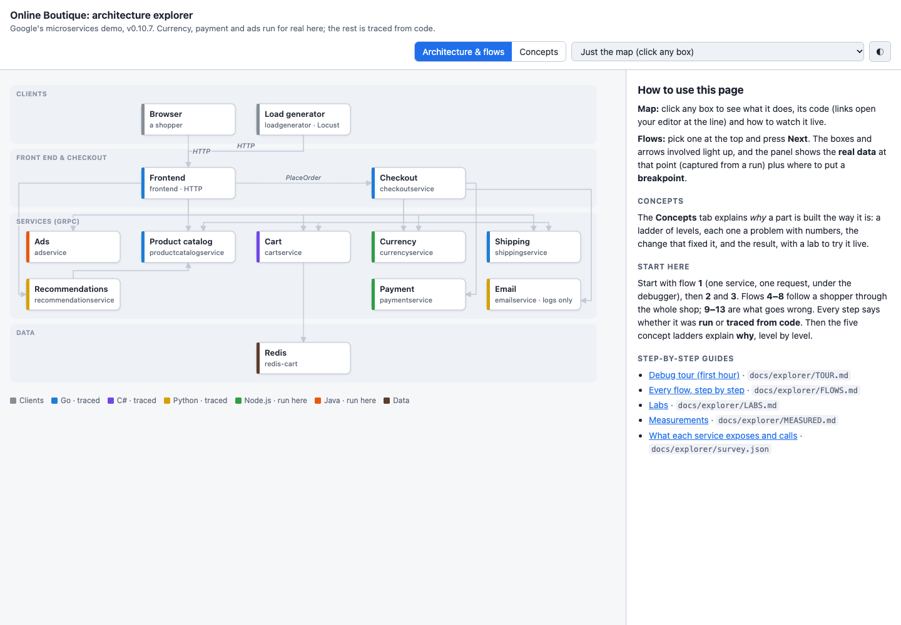
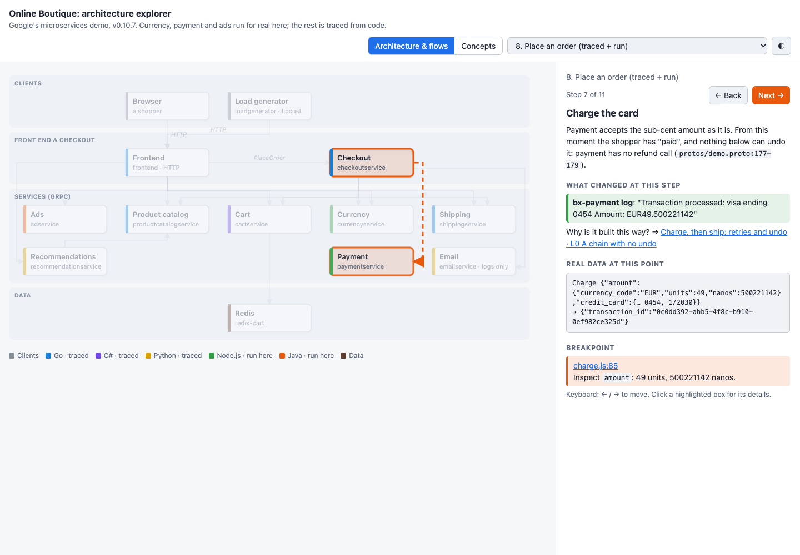
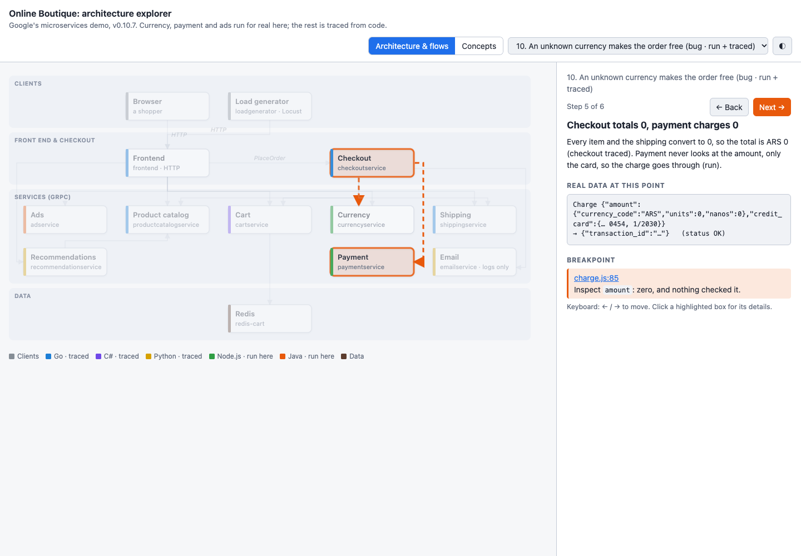
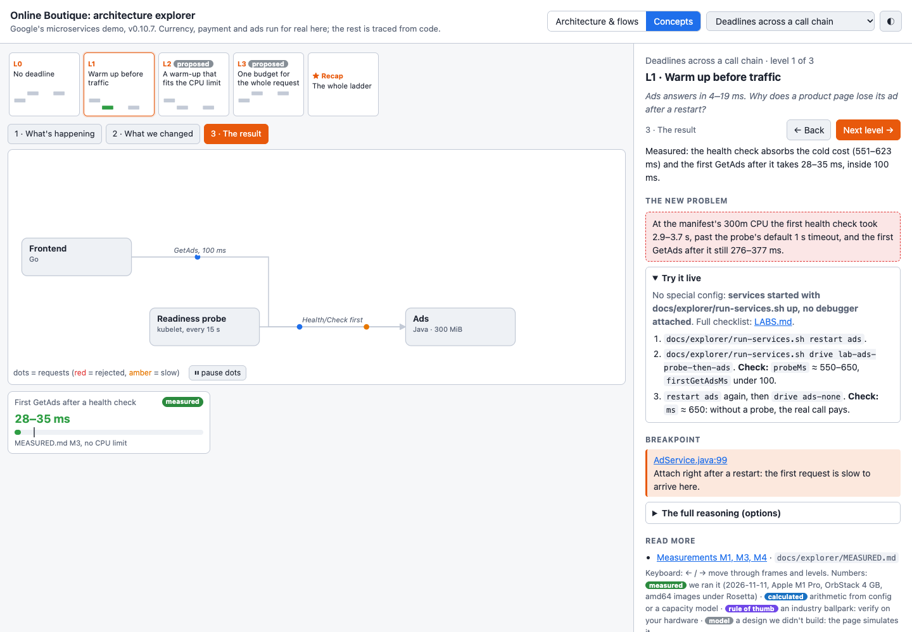

# 2. The architecture

**The feature:** `/project-explorer`, which turns a codebase you've never seen into a map you can click through and
requests you can follow with a debugger, step by step.

**In one line:** one command turned this 11-service, 5-language shop into an interactive explorer with real data at
every step, proved every breakpoint on it, and on the way found a way to place an order for nothing.

**Open it:** [the explorer, live](https://myhts.github.io/claude-kits-boutique/explorer/explorer.html), or open
[`docs/explorer/explorer.html`](../explorer/explorer.html) from a clone; code links then open your editor at the line.



## What it's for

Joining a project means learning how a request actually travels: which service calls which, what the data looks like
at each hop, and where to put a breakpoint to watch it. Reading eleven services in five languages to find that out
takes days. The explorer does the reading, runs what it can, and gives you:

- **a map** of the services and every call between them;
- **flows**: each important request as steps, with the real data at that point and a breakpoint that's been proven
  to stop there;
- **concept ladders** that explain *why* it's built this way, level by level, each level forced by a number;
- **labs** that make those numbers happen on your own laptop;
- **checklists** to work through: a first-hour tour, every flow, every lab.

## What we typed

```text
/pipeline:project-explorer run only currency, payment and ads, from Google's v0.10.7 images with plain Docker and
the memory limits from kubernetes-manifests/ (ads with DISABLE_STATS=1 DISABLE_TRACING=1); trace browse, cart and
checkout from the code
```

Why that brief: the laptop has 16 GB shared with everything else, and the later stages build features in the Node and
Java services. So three services run for real, and the other eight are read, not run. Every step on the page says
which.

## What Claude did

1. **Checked before touching anything.** No secrets in the repo. Port 7000, which currency uses, belongs to macOS
   (AirPlay), so currency got 7001. Another project's `java` and `mongod` processes were left alone. Docker stayed in
   its 4 GB box.
2. **Read the whole repo.** Nine readers on Sonnet, one per service, as [Stage 1](01-who-reads-the-code.md) decided.
   The main session checked their sheets against the repo's own contracts: all 15 gRPC methods in `demo.proto` and
   all 12 service addresses in the manifests are accounted for, and all 97 cited lines land on real code.
3. **Asked, then ran.** At the first question it offered 13 flows in four groups, a folder and a way to debug. Then
   it started the three services at the manifests' memory limits (73, 70 and 131 MiB used) and talked to them with
   real gRPC calls, from a throwaway container built from the currency image, so nothing had to be installed.
4. **Proved every breakpoint.** 22 lines, each shown to stop during a real request, through Node's inspector and
   Java's `jdb`. Two traps turned up on the way: a line Node can't stop on (the breakpoint moved to a better one),
   and a Java handler inside a nested class, which needs its `$` name to stop.
5. **Wrote the flows.** 13 flows, 71 steps: three single services, a shopper from the home page to a placed order, and
   five things that go wrong.
6. **Asked again, then measured.** At the second question we chose five concept ladders, and labs for three of them.
   Eight measurements went into [`MEASURED.md`](../explorer/MEASURED.md), each with its command and raw output.



## What it found

None of these were in the brief. They came from running the services and reading the code closely. They're reported,
not fixed: what to change is the project's call.

| What | How we know |
|---|---|
| **An order can cost nothing.** Pick a currency the shop has no rate for, and every price becomes 0; payment charges 0 and the order goes through | currency and payment run; the frontend half traced from code |
| **Payment writes the full card number and CVV to its log** | seen in the container's log |
| **A card the shop won't take becomes a server error (500)**, because payment answers with "code 400", which gRPC doesn't have | run, then traced through checkout |
| **Charges aren't whole cents:** 45 of 54 converted prices have digits below the cent, and a EUR cart was charged €49.500221142 | run |
| **The same charge twice gives two transaction ids**, so a retried order is charged twice | run |
| **Checkout waits as long as currency does.** With currency frozen, a call with no deadline was still waiting after 3 minutes | measured |
| **Ads is slow to start:** at its CPU limit, the first health check took 2.9–3.7 s, past Kubernetes' 1 s default | measured, under emulation |



## It checked itself

The rule is "never invent data or numbers", and this run shows what that buys. Three times the first answer was
wrong, and checking against the code or a measurement caught it:

- A product page price was first written as €16.80. The frontend's formatting code cuts digits instead of rounding,
  so the page shows **€16.79**.
- The home page was first said to show an ad. It asks for one, but its template never shows it.
- The first ads finding was "the first ad after a restart is always lost". A lab then showed that a Kubernetes
  health check absorbs the slow start, re-measured three times. The finding became narrower and more useful: it only
  bites at the manifest's tight CPU limit.



## See it yourself

| | |
|---|---|
| **Just look** | [the live explorer](https://myhts.github.io/claude-kits-boutique/explorer/explorer.html): start with flow 1 |
| **Follow a request** | [`docs/explorer/TOUR.md`](../explorer/TOUR.md): `docs/explorer/run-services.sh debug`, attach VS Code, send `drive convert`, watch it stop |
| **Break it** | flows 9–13 on the page, and [`LABS.md`](../explorer/LABS.md) to make the numbers happen on your machine |

Everything for it lives in [`docs/explorer/`](../explorer/). The page is built from one data file by the skill's
engine, so `node docs/explorer/tools/bundle-html.mjs …` rebuilds it after a change.

## What we decided

- **At the first question:** all four groups of flows; a single HTML file (the shop's frontend renders on the server,
  so there's no JavaScript app to put it in); the folder `docs/explorer/`; debuggers switched on when the containers
  start, with Google's images unchanged.
- **At the second question:** ladders for Deadlines, Money as integers, Chatty pages, Charge-then-ship, and Lost cart
  updates (marked as outside the Node and Java services the later stages work on). Labs where they fit, using only
  what Docker already offers (pause a container, restart it cold, cap its CPU), with no code changes. Scale target:
  ten times today's traffic, on this laptop only.

## Evidence

- [The explorer's own record](../explorer/PROGRESS.md): every decision, every proven breakpoint, every finding with
  how to reproduce it, and every correction.
- [Measurements](../explorer/MEASURED.md): M1–M8, with commands and raw output.
- [The survey](../explorer/survey.json): what each of the 12 services offers, calls and stores, with the line that
  shows it.
- [Every flow](../explorer/FLOWS.md) and [every lab](../explorer/LABS.md) as checklists, generated from the page's
  data.
- [The cost](evidence/stage-2/run-cost.txt), from [this script](evidence/stage-2/run-cost.mjs).

## What it cost

The whole run, from the first command to the hand-over, took 59 minutes and came to **$12.49 at list price**:

| Who | Model | Calls | List price |
|---|---|---|---|
| The main session: checks, map, flows, ladders, labs, every judgement | Opus 5.5 | 113 | $11.62 |
| The nine readers | Sonnet 5.5 | 33 | $0.87 |

It ran on a Claude Max plan, so nothing extra was billed; the usage screen showed about 14% of a 5-hour session and
6% of the week afterwards (its figures can include other work that day). The
usage screen suggested running the explorer on a cheaper model. Stage 1's test says otherwise: the readers already
run on Sonnet, and the 93% left is the judgement, where the three corrections above came from.

Stage 1 cost $2–4 a run, but it stopped after the survey; this run did all seven phases, including running services,
proving breakpoints and measuring labs. Prices are the published per-token list prices, with each cache write priced
by how long it was kept.

## What didn't work, and the fix

- **Some steps can't link to code.** A step only gets a clickable code link through a breakpoint, and steps read
  from code have no proven breakpoint. Those steps name the line in plain text for now. The fix belongs in
  claude-kits: a code link that isn't a breakpoint.
- **The page overflowed in two places.** The map had a fixed minimum width wider than its panel, and a box in the
  last column of a concept diagram ran off the edge. The layout checker passed both; a person looking at the
  screenshots caught them. The map was laid out again to fit; the engine and checker fixes are for claude-kits.
- **A lab hung.** After a call gave up at its deadline, the gRPC client kept retrying the frozen service, so the
  script never moved on. The driver now exits when it's done. One round of results was lost to the shell refusing
  to overwrite a file, and was re-run.
- **The lab tool speaks HTTP; these services speak gRPC.** The gRPC labs went into the explorer's own driver
  (`drive.js`) instead. The lab tool could learn gRPC.
- **Limits:** the timings ran under emulation (Google's images are built for Intel, this Mac isn't), so they show
  the shape, not production numbers. Frontend, checkout and cart never ran, so their steps are read from code ([Stage 2b](02b-the-whole-shop.md) ran them). The
  VS Code debug configs use the same ports as the proven breakpoints but weren't clicked through by hand.
