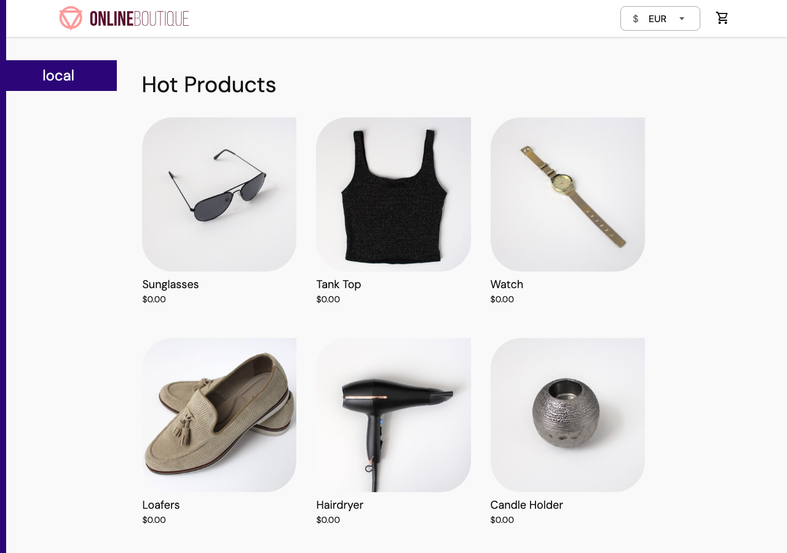
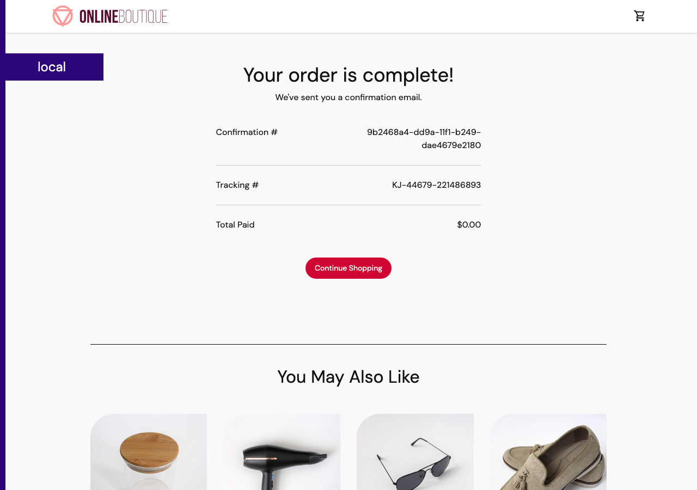
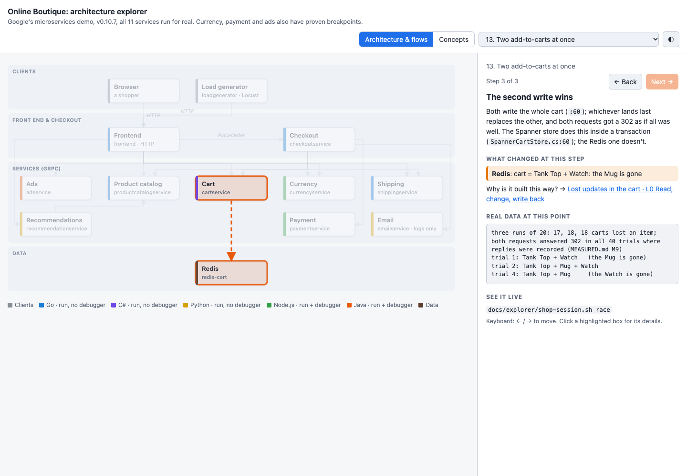

# 2b. The whole shop

**The feature:** `/project-explorer` again, picking up where [Stage 2](02-the-architecture.md) stopped. This time it
runs every service, so the steps that were only "traced from code" now carry what the running shop actually said.

**In one line:** all 11 services and Redis ran on a laptop at the manifests' memory limits. Every bug Stage 2 traced
was then made to happen through the real shop: an order really did ship for **$0.00**, two clicks really did lose
cart items in 17–18 carts out of 20, and the cart service turned out to be running at its memory limit.

**Open it:** [the explorer, live](https://myhts.github.io/claude-kits-boutique/explorer/explorer.html). Flows 4–15 are
the ones that changed.



## What it's for

Stage 2 ran three services and read the other eight. Reading code tells you what *should* happen; running it tells
you what *does*. Stage 2b closes that gap. Every step on the page now shows real data from that point in the running
shop: the HTTP reply, each service's log lines, the cart's bytes in Redis. Every bug becomes something you can
reproduce with one command.

## What we typed

The run picked up from the explorer's own record (`docs/explorer/PROGRESS.md`), with this brief:

```text
/pipeline:project-explorer Stage 2b, resume from docs/explorer/PROGRESS.md: run the whole shop (all 11 services +
redis-cart; loadgenerator optional) from Google's v0.10.7 images with plain Docker, each at its memory limit from
kubernetes-manifests/, inside the 4 GB OrbStack VM. Replace "traced from code, not run" with real captured data in
flows 4–13 (browser/HTTP through the frontend, logs, Redis, gRPC), keep the 22 Node/Java breakpoints and show them hit
from real clicks; try the traced findings for real. No Go/C#/Python debuggers (that's a later Stage B).
```

## What Claude did

1. **Checked the room first.** No other containers, every port free, 2030 MiB of memory limits for the whole shop
   inside the 4 GB Docker box. It confirmed the repo's source matches the v0.10.7 release the images were built from.
2. **Started the shop.** One command, `run-services.sh shop`: 11 services and Redis, each at its manifest limit, only
   the frontend published on `127.0.0.1:8080`. About 650 MiB used at idle.
3. **Walked a shopper through it.** A new script, `shop-session.sh`, clicks the way a browser does: home, change
   currency, product, add to cart, view cart, place order, empty cart. After every step it saves the page, every
   service's new log lines and the cart's Redis entry.
4. **Made each traced bug happen.** An Amex card, an unknown currency, ads frozen, shipping stopped after the charge,
   two add-to-carts at once: each one became a named scenario in the same script.
5. **Ran the shop's own load generator** at the manifest's 10 users, measured it, and stopped it.
6. **Proved the breakpoints from real clicks.** With debuggers on, every currency, payment and ads breakpoint the
   flows use stopped on requests from the frontend, not just from the test driver: 20 of the 22 lines (the other two
   belong to flow 1 only), and the one that should never stop still didn't.
7. **Rewrote flows 4–13 with what it saw** and added two new flows: changing currency and emptying the cart.

## What it found

The traced findings from Stage 2, now run, plus new ones that reading the code hadn't shown:

| What | How we know |
|---|---|
| **An order ships for $0.00.** Choose ARS: every price shows `$0.00` (the frontend has no symbol for ARS and falls back to `$`) while the currency picker says EUR. Payment logs `Amount: ARS0.0`, shipping ships it, email confirms it | run end to end |
| **Two add-to-carts at once lose an item in most carts:** 17, 18 and 18 carts out of 20 lost an item, and both requests got a normal reply | measured, 3 runs |
| **Shipping down after the charge means one order, two charges.** The shopper waited 20 seconds (no deadline), got an error page, kept the cart, pressed **Place order** again, and was charged again | run |
| **The cart service lives at its memory limit:** 122–127 of 128 MiB once it has served traffic. Under the shop's own load, one extra process inside the container got it killed | measured, under emulation |
| **Carts never expire.** Every cart in Redis is stored with no expiry, while the shopper's cookie lasts 48 hours | seen in Redis |
| **An Amex card gets a 500 "Uh, oh!" page**, a server error for a card problem | run |
| **A product that doesn't exist gives a 500**, not "not found" | run |
| **The shop handles its own load easily:** 408 requests in 3 minutes, 0 failures, no page over 100 ms | measured |



## It checked itself

- **Stage 2 got a detail wrong, and running it showed that.** Stage 2 called a dashed card number "the checkout
  form's default". The first real checkout was rejected with 422: the form's default has no dashes, and the frontend
  refuses the dashed form. The record now says so.
- **Stage 2 got the sum right, and running it confirmed that.** Stage 2 had added up a EUR order by hand, the way
  checkout's code does. The real checkout charged exactly that number: €49.500221142.
- **It was honest about its own mistake.** The cart service was OOM-killed while it was being inspected, and the
  kill was caused by Claude's own `docker exec`. It said so, then re-ran the load for 5 minutes without touching the
  container. Cart sat at 122–126 MiB and survived. The finding became "it lives at its limit" rather than "it
  crashes", with the incident recorded as what it was.
- **It made its reported numbers measured ones.** The lost-update rate came from one run of 20, so it ran twice more
  and recorded the replies, before "both requests got a normal reply" went on the page.



## See it yourself

| | |
|---|---|
| **Just look** | [the live explorer](https://myhts.github.io/claude-kits-boutique/explorer/explorer.html): flows 8, 10 and 12 |
| **Shop in it** | `docs/explorer/run-services.sh shop`, then open http://localhost:8080 |
| **Stop in it** | `run-services.sh shop debug`, attach VS Code ([the tour](../explorer/TOUR.md), section 4), and place an order |
| **Break it** | `docs/explorer/shop-session.sh ars` (free order), `race` (lost items), `ship-fails` (two charges), `amex`, `no-ads`, `bad-product` |

## What we decided

- **At the first question:** re-capture all four groups of flows; run the load generator briefly; add two flows that
  only make sense with the whole shop running (Change currency, Empty cart). That makes 15 flows and 78 steps.
- **Before starting:** run, don't debug, the Go, C# and Python services. Google's release images have no debugger,
  and adding one means building images from source. That's "Stage B", for later, if it's wanted.

## Evidence

- [The explorer's record](../explorer/PROGRESS.md): the Stage 2b checklist, every breakpoint hit from real clicks,
  findings 9–16 with a repro each, and the corrections.
- [Measurements](../explorer/MEASURED.md): M9 (lost updates and Redis commands), M10 (load generator and cart memory,
  including the OOM kill), M11 (shipping down after the charge).
- [Every flow as a checklist](../explorer/FLOWS.md), regenerated from the page's data.
- [`shop-session.sh`](../explorer/shop-session.sh): every scenario on this page.
- [The cost](evidence/stage-2b/run-cost.txt), from [this script](evidence/stage-2b/run-cost.mjs).

## What it cost

From "let's do Stage A" to writing this page took 46 minutes and came to **$8.14 at list price**: 99 calls, all
on Opus 5.5. No readers this time, because the survey from Stage 2 still held. That's less than Stage 2's $12.49,
because the map, the flows' structure and the tooling were already there.

| Who | Model | Calls | List price |
|---|---|---|---|
| The main session: running the shop, every scenario, the flows, the checks, this page | Opus 5.5 | 99 | $8.14 |

It ran on a Claude Max plan, so nothing extra was billed. Prices are the published per-token list prices, priced the
same way as Stage 2; the script now takes a start message as well as an end.

## What didn't work, and the fix

- **The first order was refused.** The script used Stage 2's dashed card number, and the frontend rejected it. The
  fix was the form's own default, and the correction above.
- **The first log capture blurred steps together.** The timestamps had whole-second precision, so each step picked up
  lines from the step before. Millisecond timestamps fixed it.
- **"Shipping fails after the charge" can't be done by stopping shipping.** Checkout asks shipping for a quote
  *before* it charges, so a stopped shipping service blocks the order before any money moves. The scenario freezes
  payment, waits until checkout has its quote, stops shipping, then lets payment go.
- **One breakpoint check reported zero hits.** It was pointed at currency's debugger port instead of payment's. The
  verifier says "not hit" instead of passing quietly, so the mistake showed straight away; on the right port, every
  line stopped.
- **Limits:** no breakpoints in Go, C# or Python (Stage B). Catalog logs nothing per request, so its data comes from
  the test driver sending the same request. Everything ran under emulation (Google's images are built for Intel), so
  the timings and memory figures are this machine's, not production's. The shipping-down timing was run once.
